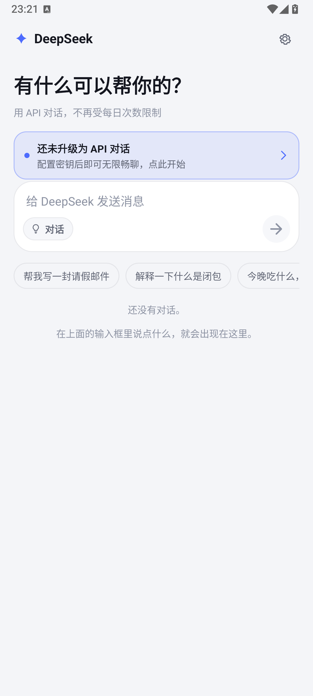
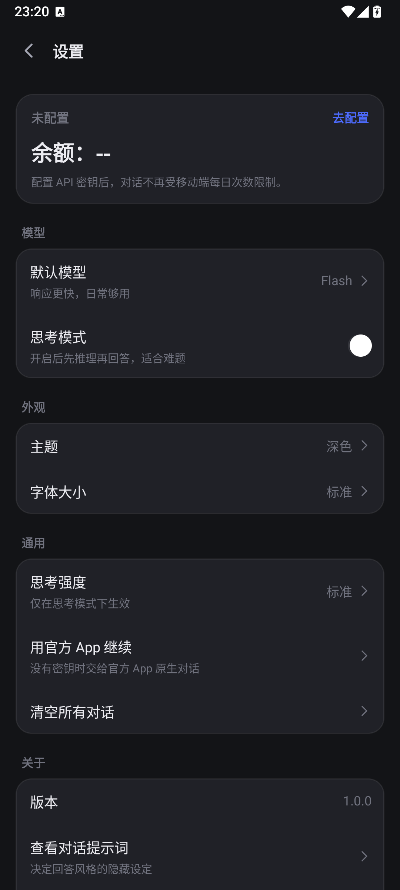
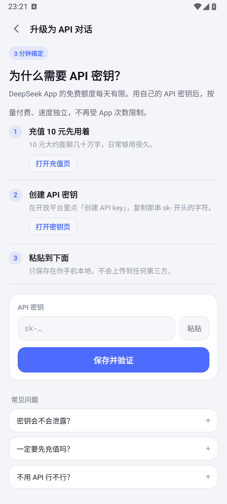
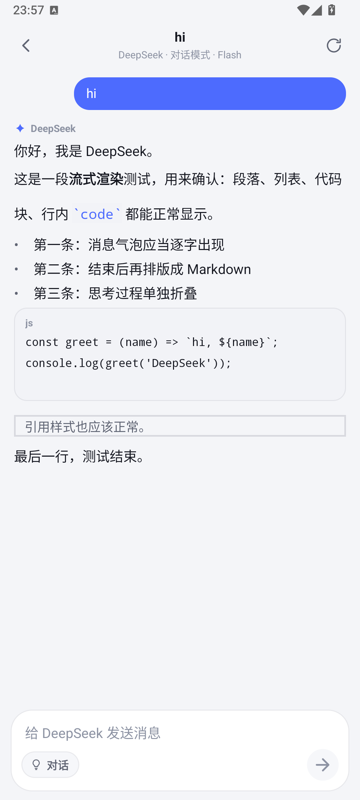

# DeepSeek-Mobile

复刻 DeepSeek 官方移动端观感的 Android 客户端，把会话部分升级成 **API 直连**，绕开 App 每日次数限制。

不修改、不重打包官方 APK：这是一个独立应用，界面按官方 App 的视觉与结构自行实现，密钥只存本机。

## 它解决什么

官方 App 的免费额度每天有限。用你自己的 DeepSeek API 密钥后，按量付费、速度独立，不再受次数限制。没配密钥时，可以一键交回官方 App 原生对话。

## 功能

- **对话 / 思考两种模式**：底部胶囊按钮切换，思考模式会展示可折叠的推理过程
- **默认 Flash，可切 Pro**：设置页一行切换（`deepseek-flash` / `deepseek-v4-pro`）
- **萌新引导**：内置浏览器打开开放平台，三步走完「充值 → 建密钥 → 回填」，保存时自动验证并查余额，余额为 0 时直接引导充值
- **对话提示词**：每次请求附带一段固定的系统提示词，解决裸调 API 「AI 助手腔」的问题
- **全中文错误**：400/401/402/422/429/500/503/504、断网、超时、密钥失效，都给中文解释和可点的下一步
- **本地优先**：会话、设置、密钥全部存在手机本地，没有服务端

## 界面

| 首页 | 设置 | 引导 |
| --- | --- | --- |
|  |  |  |

对话页（流式 + Markdown 排版）：



## 两条路线

### 路线 A：独立 App（已可用）

`app/` 目录。自绘界面，按官方 App 的配色与结构实现，全部功能已跑通：流式、思考模式、余额、错误中文化。

```powershell
powershell -ExecutionPolicy Bypass -File build.ps1        # 产物 build/deepseek-mobile.apk
```

### 路线 B：LSPatch / LSPosed 模块（骨架已跑通，协议未完成）

`module/` 目录。不修改官方 APK 的代码逻辑，用 LSPatch 把模块嵌进官方包，界面完全由官方 App 自己渲染。

```powershell
powershell -ExecutionPolicy Bypass -File build-module.ps1  # 产物 build-module/dsm-hook.apk

# 用 LSPatch 嵌入官方 APK（仅本地自用，不要分发打好的包）
java -jar lspatch.jar deepseek.apk -m build-module/dsm-hook.apk -o out/ `
     -k keystore/debug.jks android dsm android
```

**当前状态**：模块能被加载、hook 框架生效、可记录类加载与网络请求。

**尚未完成的部分（需要真实账号才能继续）**：官方 App 的网络栈是 Ktor + OkHttp，类名被 R8 混淆（`okhttp3.Request`、`io.ktor.client.HttpClient` 均不可按名引用），会话接口 `/api/v0/chat/completion` 由混淆类 `Lc6b` 构造。要完成「把会话改道到 api.deepseek.com」，还需要：

1. 登录账号，抓一次真实会话的请求体与 SSE 响应格式
2. 写请求改写 + 响应格式转换（OpenAI 兼容格式 → 官方 App 期望的格式）
3. 处理 PoW 挑战与登录态

> 注意：用 LSPatch 打出来的包内含官方代码，只能自己用，不能公开分发。

## 构建

零 Gradle：`aapt2 → javac → d8 → zipalign → apksigner`，一次构建几秒。

```powershell
# 依赖：Android SDK（build-tools + platform android-36）
# 默认路径 D:\.tools\android-sdk，可在 build.ps1 顶部改
powershell -ExecutionPolicy Bypass -File build.ps1
```

产物：`build/deepseek-mobile.apk`。

没有 Android SDK 时，把 `build.ps1` 里 `$sdk` 指向本地 SDK 目录即可；`platforms/android-36/android.jar` 与 `build-tools/*/aapt2.exe` 是必需项。

## 使用

1. 打开应用 → 顶部提示条「还未升级为 API 对话」
2. 按引导在开放平台充值、创建密钥
3. 粘贴密钥 → 保存并验证
4. 回到首页开始聊

不配密钥也能用：会话页会提供「用官方 App 继续」，交给 DeepSeek App 原生完成。

## 关于提示词

裸调 API 时回答容易带一堆客套。`Api.java` 里的提示词把官方 App 的说话方式固化下来：直接给答案、默认简短、不编造、不滥用格式，并附带当前时间。设置页可以查看完整内容。

## 技术要点

- 单 Activity + 自绘 View 树，无 AndroidX、无第三方依赖，APK 约 110 KB
- `HttpURLConnection` 手写 SSE 流式解析，思考模式区分 `reasoning_content` 与 `content`
- 颜色/圆角/间距按官方 App 实测值对齐，支持深色、浅色、跟随系统三档

## 免责声明

本项目与 DeepSeek 官方无关，未使用官方任何代码或资源文件。「DeepSeek」仅为说明用途。请遵守 DeepSeek 的服务条款，密钥泄露或滥用风险由使用者自行承担。

## License

MIT
